<picture>
  <source media="(prefers-color-scheme: dark)" srcset="assets/banner-dark.svg">
  
</picture>

  
  
  
  

## 👋 About me

I'm a **Senior Full Stack Engineer, Tech Lead and Software Architect** from Canoas, Brazil, building for the web
since 2009. I design and ship SaaS and e-commerce platforms end to end, from database modeling and ERP
integrations to the UI, CI/CD and the servers they run on. Lately I spend a lot of time on **automation and AI
agents** that take manual work off people's plates.

- 🔭 Leading **Digital 2.0** at Fideliza Tchê Farmácias: a multi-store Laravel + Vue platform for catalog, pricing,
  internal communication and promotional design
- 🤝 I've led teams, co-founded an agency and like translating business problems into architecture
- 🌎 Open to **remote roles** with Brazilian and international teams
- 🐧 Daily driver: Linux ([Omarchy](https://omarchy.org) / Hyprland). I build my own tools

## 📈 Impact

| Result | Where |
| --- | --- |
| E-commerce grew from **R$ 3k to R$ 450–500k per month**, with **140+ stores** integrated | Maxxi Econômica |
| **R$ 120k** in a single day on the first Black Friday | Maxxi Econômica |
| Support tickets down from **~15 to 1–2 per day**; price-label prep from **3 days to half a shift** | Digital Maxxi |
| Promotional artwork platform **adopted by 3 other pharmacy businesses** | Digital Maxxi |
| **960+ automated tests** on a multi-tenant Laravel platform | Digital 2.0 |
| Typical project delivery cut from **6–7 days to ~2** | Reweb |

## 💼 Experience

| Role | Company | Period |
| --- | --- | --- |
| Tech Lead & Marketing Manager | Fideliza Tchê Farmácias | 2026 – present |
| Senior Software Engineer | Husky (logistics SaaS) | 2025 – 2026 |
| Tech Lead & Digital Manager | Maxxi Econômica Farmácias | 2020 – present |
| Co-founder, Tech Lead & Full Stack Engineer | Trunfo → Feito (digital agency) | 2014 – 2019 |
| PHP Full Stack Developer & Project Co-lead | Reweb | 2013 – 2014 |

Full story at [guiflores.dev](https://guiflores.dev).

## 🚀 Featured projects

| Project | What it is | Stack |
| --- | --- | --- |
| **[Patrão do Parlamento](https://www.patraodoparlamento.com.br)** | Public-data platform about Brazilian congress members: votes, elections, spending and shareable ballot notes | Next.js · TypeScript · Upstash Redis · Vercel |
| **[X DeleTweets](https://github.com/gbflores/x-deletweets)** · [site](https://gbflores.github.io/x-deletweets/) | Open-source tool to bulk delete your posts, replies, reposts and likes on X, right in the browser | JavaScript · Userscript |
| **[Postaí](https://github.com/gbflores/postai)** | Write once, publish to X, Threads, LinkedIn, Facebook and Instagram, with a confirmation link per network. Runs locally, no paid APIs, with a CLI and Claude Code skill | Node.js · TypeScript · Playwright · Hono |
| **[Math Practice App](https://github.com/gbflores/math-app)** · [demo](https://math-app-psi.vercel.app) | Gamified mental-math practice for kids, with short sessions and instant feedback | Next.js · TypeScript · Tailwind |
| **[Omarchy Local Projects](https://github.com/gbflores/omarchy-local-projects)** | Desktop bar widget listing local dev servers (native and Docker) with CPU/memory and one-click kill | QML · Linux |
| **[Transportes Rodoflex](https://transportesrodoflex.com.br/)** | Full redesign and custom admin panel for a nationwide freight carrier | Laravel · Web design · CI/CD |

> Most of my professional work lives in private company repositories. Happy to walk you through architecture
> and code in an interview.

## 🛠️ Tech stack

**Backend**
 

**Frontend**
 

**Data**
 

**Infra & DevOps**
 

**Quality, AI & automation**
 

## 📫 Let's talk

Hiring or have a project in mind? Reach me on [LinkedIn](https://www.linkedin.com/in/guifloresdev/), by
[email](mailto:guilhermebflores@gmail.com) or through the form at [guiflores.dev](https://guiflores.dev).

🇧🇷 Em português

 

Sou **Engenheiro Full Stack Sênior, Tech Lead e Arquiteto de Software** em Canoas (RS) e desenvolvo para a web
desde 2009. Construo plataformas SaaS e de e-commerce de ponta a ponta, do banco de dados e das integrações com ERP
até a interface, o CI/CD e os servidores, e tenho trabalhado bastante com automação e agentes de IA.

Liderei o e-commerce da Maxxi Econômica de R$ 3 mil para R$ 450–500 mil por mês com mais de 140 lojas integradas,
fui cofundador de agência e hoje lidero o Digital 2.0 na Fideliza Tchê Farmácias.

Estou **aberto a oportunidades remotas**, no Brasil e no exterior. Fale comigo pelo
[LinkedIn](https://www.linkedin.com/in/guifloresdev/), por [e-mail](mailto:guilhermebflores@gmail.com) ou em
[guiflores.dev](https://guiflores.dev).

